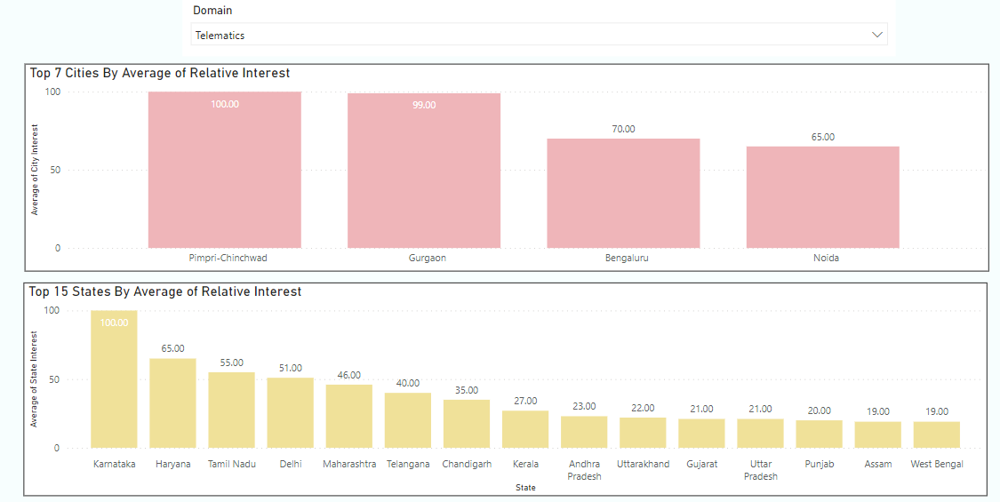
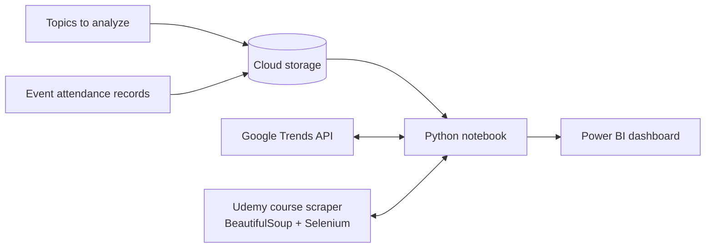

# Member Interest Analysis

Capstone project for Virginia Tech's Certificate Program in Business Analytics and AI (Alexandria cohort, 2022). We worked with a national association of mobility engineers in India, covering automotive, aerospace and off-highway. It is referred to here as the *Indian Mobility Association (IMA)* to keep its identity and its members' data private.

## The problem

The association runs dozens of training programs and conferences a year for about 5,000 paying members, across more than 30 specialist topics, from powertrain and battery management to aerospace standards. It wanted to decide what to run and where using data, not guesswork. That came down to three questions:

| Question | Goal |
| --- | --- |
| Which topics do conference participants like? | Analyze and categorize topics |
| What do professional members need next? | Forecast topic trends |
| Which topics matter in which cities? | Build a dashboard for ongoing use |

## What we built

1. **Consolidated the association's records:** 12,597 rows of training attendance, conference delegate rosters, panel registrations and yearly membership data from April 2021 to March 2022, with member names masked.
2. **Measured public interest in each topic** with Google Trends, by state, by city and over time.
3. **Scraped Udemy** for courses in each topic, collecting enrollment, ratings, length and recency as a signal of what engineers are paying to learn.
4. **Forecast topic interest** with exponential smoothing.
5. **Built a Power BI dashboard** with views of interest by state, interest by city, topic-level detail, India-wide trends with a forecast, and Udemy trends.

## Selected findings

- **Telematics interest is concentrated in a few auto hubs.** Pimpri-Chinchwad (100) and Gurgaon (99) lead, followed by Bengaluru (70) and Noida (65). Karnataka leads the states (100), followed by Haryana (65) and Tamil Nadu (55).
- **Powertrain interest clusters in Pune and Pimpri-Chinchwad,** with smaller pockets in Gurgaon and Bengaluru.
- **Design-related courses have the largest audiences on Udemy:** about 162,000 students on average, ahead of fatigue analysis (77,000) and machine design (66,000).
- **India-wide interest in telematics fell from 2017 to 2021,** then rose in 2022, and the forecast puts 2023 slightly lower.

These are relative Google Trends scores (0–100), so they compare places and topics with each other, not absolute numbers of people.

## Documentation

The full write-up, with the data model and each dashboard view, is in [docs/report.md](docs/report.md).

Team project of three. Built with Python (pandas, NumPy, BeautifulSoup, Selenium), the Google Trends API and Power BI. The notebooks and dashboard file weren't preserved, so this repository documents the project and its results.
