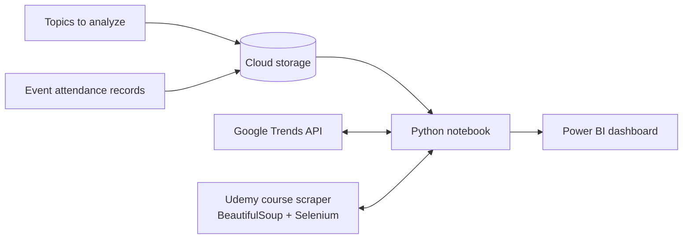
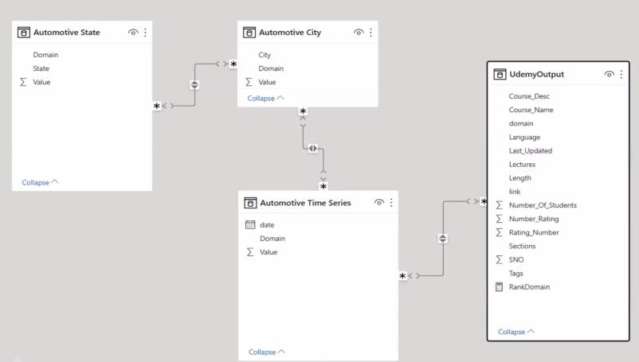
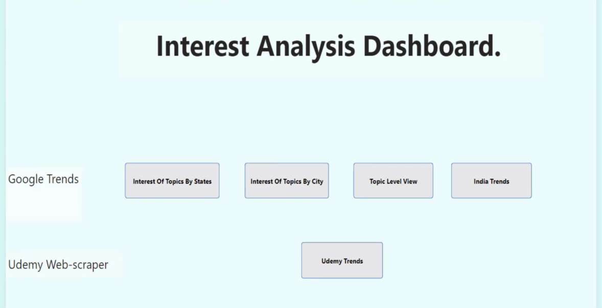
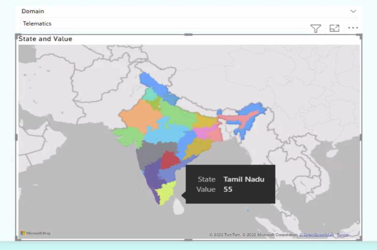
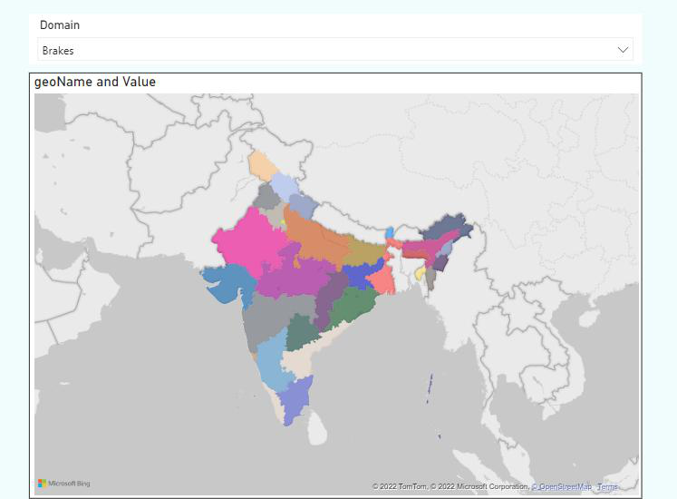
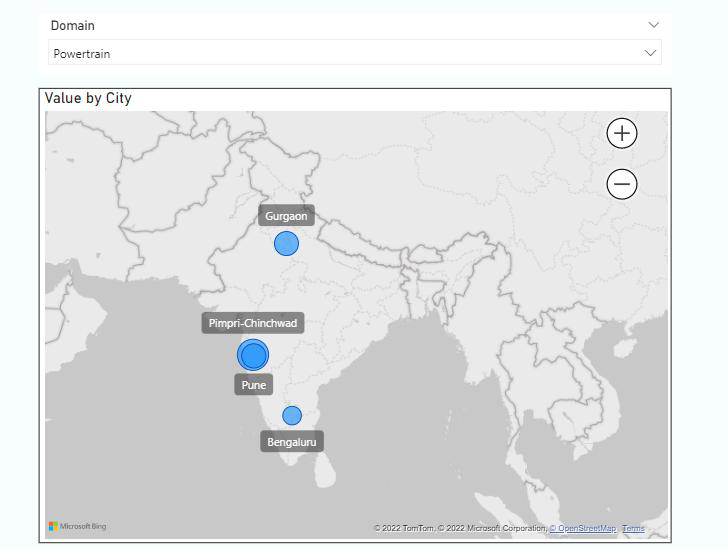
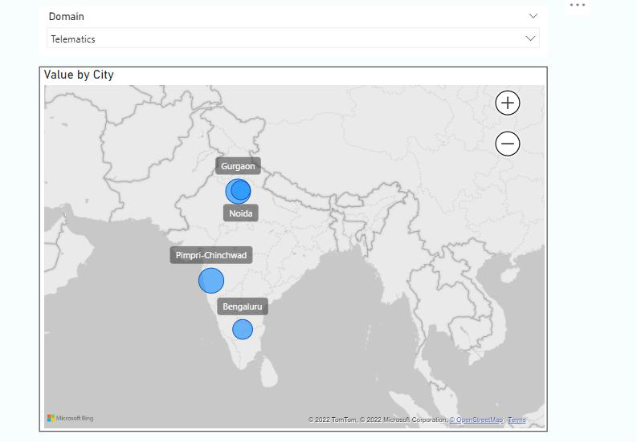
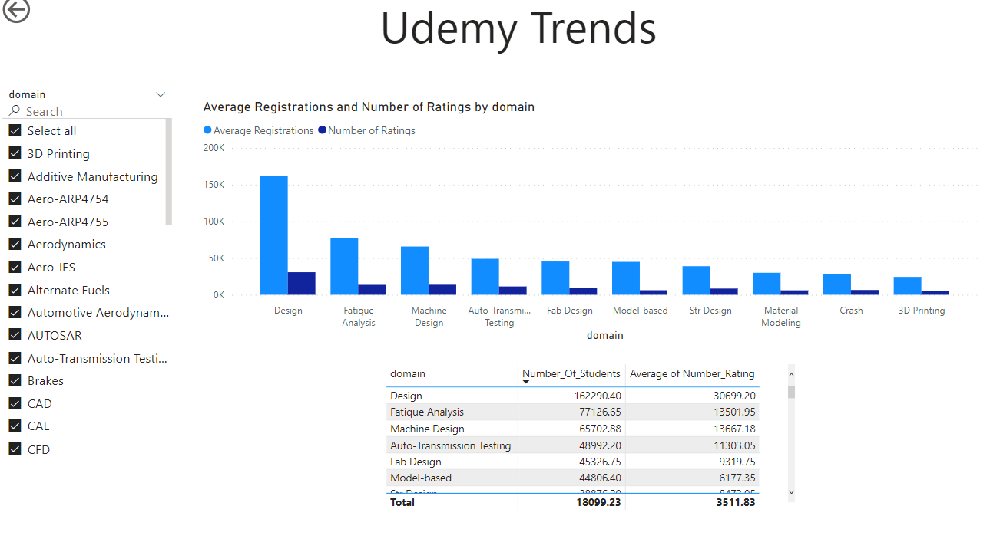
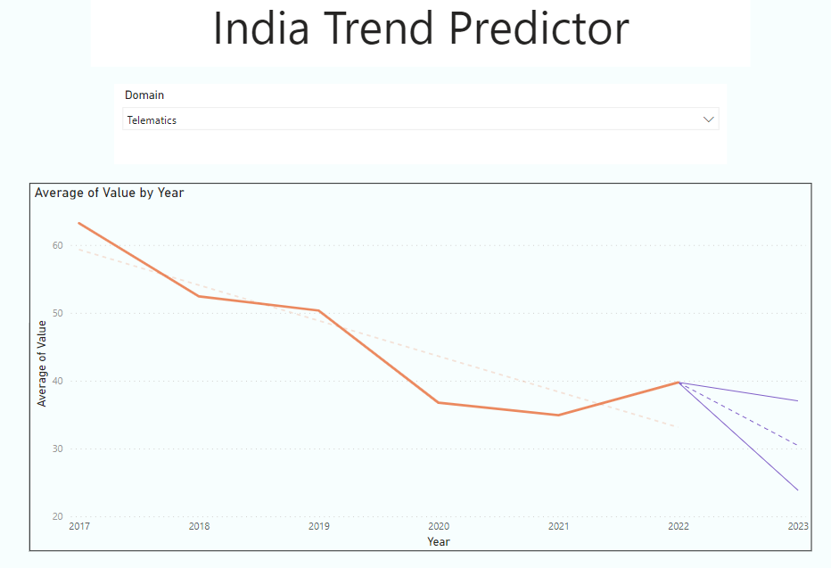

# Member Interest Analysis: Capstone Report

*Virginia Tech Certificate Program in Business Analytics and AI, Alexandria cohort. August 2022.*

## 1. The organization

The partner is a 25-year-old professional association for mobility engineers, based in Chennai, with members across India. It is called the *Indian Mobility Association (IMA)* here to keep its identity private, and member and program names in the data were masked.

- **Sectors:** automotive, aerospace and off-highway.
- **Members:** about 5,000 professionals who pay an annual fee, plus a database of about 9,000 practicing mobility engineers.
- **Programs:** 85 professional development programs (deep-dive trainings) and 6 technical conferences in the last fiscal year, delivered online, in person and in hybrid formats.
- **Industry context:** Indian vehicle production grew at a 2.36% CAGR between FY16 and FY20, reaching 26.36 million vehicles in FY20.

### Measures of success

The association measures itself against seven goals:

1. Build and practice a member-service culture.
2. Align its products and services with its mission.
3. **Use data-driven strategies.**
4. Improve dialogue and engagement with members.
5. Act as a broker of ideas.
6. Adapt to India's changing mobility landscape.
7. Build alliances that benefit members.

This project addresses goal 3 directly, and supports goals 2, 4 and 6.

### Who the members are

Members fall into two age groups, 21–28 and over 28. They work at OEMs, Tier 1 and Tier 2 suppliers, R&D centers and software services companies. They look to the association for more than 30 specialist topics, such as powertrain, engines, battery management and aerospace standards. These fall into four broad categories: emerging trends, engineering fundamentals, specialized expertise, and integration of two or more specialties.

## 2. Objectives

| Problem | Objective |
| --- | --- |
| Which topics do conference participants like? | Analyze the topics, categorize them and apply algorithms |
| What do professional members need? | Apply trend-forecasting algorithms |
| Which topics are relevant in which cities, across the country? | Build a dashboard the association can keep using |

**Project goals:**
- Apply the program's methods, including statistical analysis, classification and Python programming.
- Choose the most appropriate models and turn them into a working solution.
- Build a prototype that shows the solution, along with a report on its objectives and development.

## 3. Scope

| | Association | This project |
| --- | --- | --- |
| **Domain** | Automotive, aerospace, off-highway | Descriptive and predictive analytics, data mining, dashboard development |
| **Delivery** | Online, in person, hybrid | Python, scikit-learn, BeautifulSoup, Selenium, Power BI |
| **Events and models** | Trainings, conferences, other events | Trends from public education platforms and search interest, classification and clustering |
| **Data** | Excel and HTML exports, portal registrations, April 2021 – March 2022 | Registration records, Google Trends, online course platforms |

## 4. Plan

The project ran in four two-week phases:

1. Data consolidation and preparation
2. Exploratory and predictive analytics
3. Deriving insights
4. Automation and dashboard development

| Week | Data engine | Data model | Dashboard |
| --- | --- | --- | --- |
| 1 | Collect and classify relevant data | Set up weekly team calls | n/a |
| 2 | Collect and classify relevant data | Review the algorithms and models covered in the course | n/a |
| 3 | Review course material | Choose the three most relevant models | Review past capstone projects |
| 4 | Study similar projects (ETL) | Compare the three models | Choose the dashboard platform |
| 5 | Build 50% of the project | Complete the coding and models | Design the dashboard flow |
| 6 | Complete the coding and models | Review progress against the business objective | Initial build |
| 7 | Integrate with the dashboard and fix errors | n/a | Fix bugs and review with mentors |
| 8 | Run with sample data and release | n/a | Beta release |

## 5. Data

The association's records came from training attendance, conference delegate rosters, panel discussion registrations and yearly membership data: **12,597 records** in Excel, covering every event from 1 April 2021 to 31 March 2022. They were filtered and grouped by topic.

Two external sources measured interest beyond the association's own members:

- **Google Trends:** relative search interest in each topic by state, by city and over time, through its API.
- **Udemy:** a scraper built with BeautifulSoup and Selenium collected each topic's courses, with student counts, ratings, length, number of lectures and last-updated dates.

## 6. Method

1. Load the topic list and the association's attendance records into cloud storage.
2. In a Python notebook, query Google Trends for each topic, and scrape the matching Udemy courses.
3. Clean and consolidate the results with pandas.
4. Forecast each topic's interest with exponential smoothing.
5. Publish everything to a Power BI dashboard.

### Data model

Three Google Trends tables (interest by state, by city and over time, each keyed by topic) link to a table of scraped Udemy courses.

## 7. Dashboard and results

The dashboard has four Google Trends views (interest by state, interest by city, topic-level detail and India-wide trends) plus a Udemy trends view.

### Interest by state

| Telematics | Brakes |
| --- | --- |
|  |  |

Choosing a topic colors each state by its relative interest. For example, Tamil Nadu scores 55 for telematics.

### Interest by city

| Powertrain | Telematics |
| --- | --- |
|  |  |

Powertrain interest centers on Pune and Pimpri-Chinchwad, with smaller pockets in Gurgaon and Bengaluru. Telematics adds Noida.

### Topic summary

**Telematics, top cities:** Pimpri-Chinchwad 100, Gurgaon 99, Bengaluru 70, Noida 65.
**Telematics, top states:** Karnataka 100, Haryana 65, Tamil Nadu 55, Delhi 51, Maharashtra 46, Telangana 40, Chandigarh 35, Kerala 27.

### Udemy trends

| Topic | Average students per course | Average number of ratings |
| --- | --- | --- |
| Design | 162,290 | 30,699 |
| Fatigue analysis | 77,127 | 13,502 |
| Machine design | 65,703 | 13,667 |
| Auto-transmission testing | 48,992 | 11,303 |
| Fabrication design | 45,327 | 9,320 |
| Model-based design | 44,806 | 6,177 |

### India trend forecast

India-wide interest in telematics fell from about 63 in 2017 to about 35 in 2021, recovered to about 40 in 2022, and the forecast for 2023 is around 30, with a range of roughly 24 to 37.

All interest values are relative Google Trends scores from 0 to 100. They compare places, topics and years with each other, not absolute numbers of people.

## 8. Methods applied

- Predictive analytics and forecasting
- Data acquisition through web scraping and APIs
- Python with NumPy and pandas
- Extract, transform and load (ETL)
- Visualization, dashboards and reporting in Power BI

## 9. Challenges

- Many variants of each topic, which made it hard to pick the top five.
- Relying on approximations, since search interest only stands in for real demand.
- Aligning the results with the association's real expectations.
- Building a dashboard that stays robust and maintainable after hand-off.
